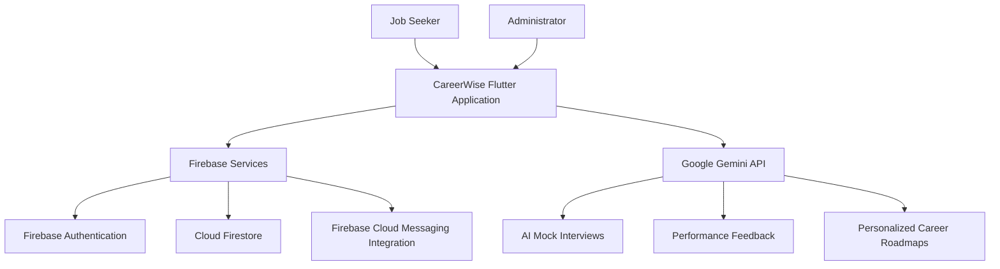
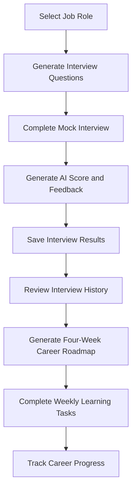

# 🚀 CareerWise — AI-Powered Career Decision Support & Job Application Platform


**Prepare smarter. Apply confidently. Grow continuously.**

CareerWise is an AI-powered career decision support system designed to help job seekers make informed career decisions through intelligent job application management, AI-powered mock interviews, personalized career roadmaps, and performance analysis.

Built with Flutter, Firebase, and Google Gemini AI, CareerWise integrates artificial intelligence and real-time cloud services to support career planning, interview preparation, and informed career decision-making.

## ✨ Key Features

### 👤 Job Seeker Module
- Secure registration and login using Firebase Authentication.
- Browse and search available job opportunities.
- Submit and track job applications.
- Request application cancellation and manage application history.
- Manage personal profiles and receive application updates.

### 🤖 AI Mock Interviews
- Generate interview questions tailored to selected job roles using Google Gemini AI.
- Practice interviews with a countdown timer and question navigation.
- Receive AI-generated performance scores, strengths, improvement suggestions, and preparation tips.
- Handle temporary AI service failures with automatic retries and fallback support, subject to model availability.

### 📊 Interview History & Results
- Review previous interview sessions, questions, answers, and feedback.
- Track total interviews, average scores, and best scores.
- Search by job title or company and filter by score.
- Access personalized career roadmaps from saved interview results.

### 🗺️ AI Career Roadmap
- Generate personalized four-week development plans based on interview performance.
- Identify target skills and weekly learning objectives.
- Complete 12 actionable learning tasks using interactive checkboxes.
- Track completion progress through visual progress indicators.
- Save roadmaps and task progress in Cloud Firestore.

### 🛡️ Admin Module
- Create and manage job listings.
- Review job applications and update application statuses.
- Manage cancellation requests and cancelled applications.
- Monitor application statistics and applicant recommendations.

### 🔔 Notifications
- Application status updates and in-app notification history.
- Firebase Cloud Messaging integration for push notifications where configured.

### 🎨 User Interface
- Consistent Emerald Green design system.
- Light and Dark Mode support.
- Modern gradient banners, responsive layouts, and progress indicators.
- User-friendly navigation across career development screens.

## 🛠️ Technology Stack

| Technology | Purpose |
|---|---|
| Flutter | Cross-platform application framework |
| Dart | Application programming language |
| Firebase Authentication | User identity and authentication |
| Cloud Firestore | Cloud database and real-time data storage |
| Firebase Cloud Messaging | Push notification integration |
| Google Gemini API | AI-powered career recommendations, job matching, mock interviews, performance feedback, and personalized career roadmaps |
| Git & GitHub | Version control and collaboration |
| Android Studio | Development environment |

## 🏗️ System Architecture



The application uses Flutter for the interface, Firebase for authentication and data management, and Gemini for AI-powered career development features. Push notification delivery requires appropriate Firebase configuration and a trusted sending environment.

## 📁 Project Structure

```text
careerwise_sample/
├── android/
├── ios/
├── web/
├── lib/
│   ├── screens/
│   │   ├── ai_mock_interview_screen.dart
│   │   ├── interview_history_screen.dart
│   │   ├── career_roadmap_screen.dart
│   │   └── ...
│   ├── services/
│   │   ├── career_roadmap_service.dart
│   │   └── ...
│   └── main.dart
├── .vscode/
│   └── launch.json
├── .gitignore
├── pubspec.yaml
└── README.md
```

*Selected files are shown. Local secrets and environment configuration are not included in version control.*

## ⚙️ Getting Started

### Prerequisites

- Flutter SDK (includes Dart)
- Android SDK and Android Studio or Visual Studio Code
- Git
- Firebase project
- Google Gemini API key
- Android device or a supported development target

### 1. Clone the repository

```bash
git clone <https://github.com/Tharaka234/careerwise-ai.git>
cd careerwise-ai
```

Replace `<repository-url>` with the actual GitHub repository URL and adjust the directory name if needed.

### 2. Install dependencies

```bash
flutter pub get
```

### 3. Configure Firebase

Create or connect a Firebase project and enable Firebase Authentication and Cloud Firestore. Configure Firebase Cloud Messaging if using push notifications.

If Firebase configuration is not already available, install the Firebase CLI, sign in, and configure FlutterFire:

```bash
firebase login
dart pub global activate flutterfire_cli
flutterfire configure
```

Configure authentication providers and Firestore security rules to match the application's user and administrator access requirements.

### 4. Configure the Gemini API key

Obtain an API key from [Google AI Studio](https://aistudio.google.com/apikey).

Create a local `env.json` file in the project root:

```json
{
  "GEMINI_API_KEY": "YOUR_GEMINI_API_KEY"
}
```

Ensure `.gitignore` includes:

```gitignore
env.json
.env
```

Use a Gemini model available to your API project. Model availability and quotas may change.

### 5. Run the application

Check connected devices:

```bash
flutter devices
```

Run on an Android device:

```bash
flutter run --dart-define-from-file=env.json
```

For local web testing:

```bash
flutter run -d chrome --dart-define-from-file=env.json
```

### 6. Optional: VS Code launch configuration

Add the following configuration to `.vscode/launch.json` (preserve any existing configurations):

```json
{
  "version": "0.2.0",
  "configurations": [
    {
      "name": "CareerWise",
      "request": "launch",
      "type": "dart",
      "toolArgs": ["--dart-define-from-file=env.json"]
    }
  ]
}
```

Select a device and press `F5` to launch without manually typing the API key.

## 🧠 AI Career Development Workflow



## 🔐 Security & Responsible AI

- Use Firebase Authentication and appropriate Firestore security rules to protect user data.
- Restrict administrative operations to authorized users.
- Never commit private API keys or service account credentials.
- `env.json` and `--dart-define` are development conveniences, not secure secret storage. Keys can be extracted from compiled clients. Production AI requests should use an authenticated server-side integration.
- AI-generated scores and recommendations are educational guidance, not definitive hiring assessments.

## 📸 Application Screenshots

Suggested screenshots to add to the repository:

| Job Seeker | AI Career Development | Administrator |
|---|---|---|
| Home Screen | AI Mock Interview | Admin Dashboard |
| Job Listings | Interview Results | Job Management |
| My Applications | Interview History | Application Management |
| User Profile | Career Roadmap | Cancellation Requests |
| Notifications | Light & Dark Mode | Applicant Recommendations |

## 🧪 Testing & Build

```bash
flutter analyze
flutter test
flutter build apk --dart-define-from-file=env.json
```

Use development credentials for local testing only. Do not distribute builds containing private Gemini API keys.

## 🚧 Future Enhancements

- AI-powered CV analysis and resume improvement suggestions.
- Skill-based intelligent job matching.
- Voice-based mock interviews.
- Advanced career performance analytics.
- Multilingual support.
- Secure server-side AI integration.

## 🎓 Project Purpose

CareerWise is an academic software development project demonstrating the integration of mobile application development, artificial intelligence, cloud services, and modern user interface design to support job seekers and their professional growth.

## 🤝 Contributing

Suggestions and improvements are welcome. Fork the repository, create a feature branch, commit your changes, and submit a pull request.

## 🙏 Acknowledgements

- [Flutter](https://flutter.dev/)
- [Firebase](https://firebase.google.com/)
- [Google Gemini API](https://ai.google.dev/)
- The open-source developer community

---

**CareerWise — Prepare smarter. Apply confidently. Grow continuously. 🚀**

Built with Flutter, Firebase, and Google Gemini AI.
