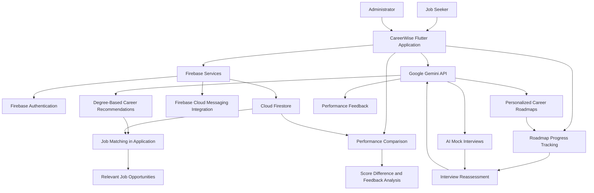
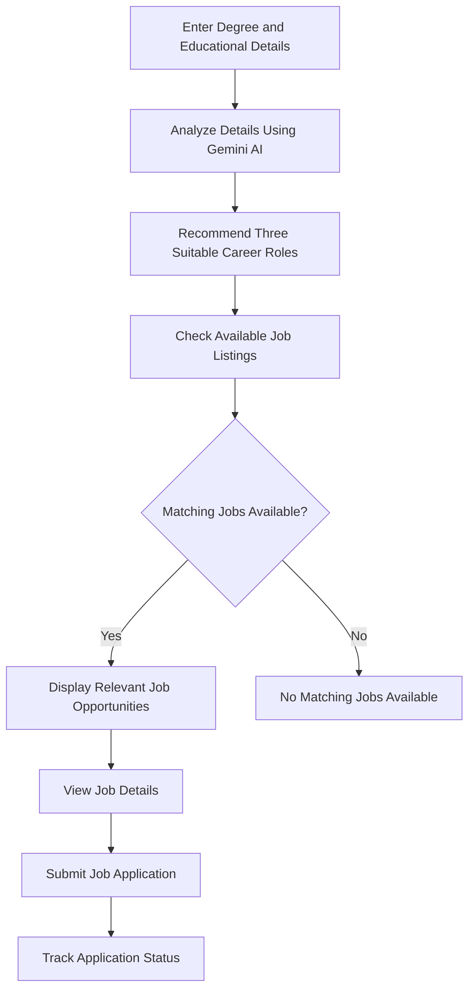
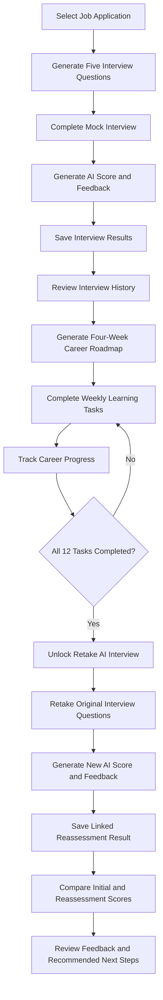

# 🚀 CareerWise — AI-Powered Career Decision Support & Job Application Platform


**Prepare smarter. Apply confidently. Grow continuously.**

CareerWise is an AI-powered career decision support system designed to help job seekers make informed career decisions through degree-based career recommendations, relevant job matching, job application management, AI-powered mock interviews, personalized career roadmaps, interview reassessment, and before-and-after performance comparison.

Built with Flutter, Firebase, and Google Gemini AI, CareerWise integrates artificial intelligence and real-time cloud services to support career exploration, job discovery, interview preparation, and informed career decision-making through a continuous practice, learning, and reassessment cycle.

## ✨ Key Features

### 👤 Job Seeker Module
- Secure registration and login using Firebase Authentication.
- Browse and search available job opportunities.
- Submit and track job applications.
- Request application cancellation and manage application history.
- Manage personal profiles and receive application updates.

### 🎯 AI Career Recommendations & Job Matching
- Analyze user-provided degree and educational details using Google Gemini AI.
- Recommend three suitable career roles based on academic qualifications.
- Display available job listings that match the recommended roles, when available.
- Allow users to explore relevant opportunities and submit job applications.
- Support informed career decision-making through personalized recommendations.

### 🤖 AI Mock Interviews
- Generate interview questions tailored to selected job roles using Google Gemini AI.
- Practice interviews with a countdown timer and question navigation.
- Receive AI-generated performance scores, strengths, improvement suggestions, and preparation tips.
- Handle temporary AI service failures with automatic retries and fallback support, subject to model availability.

### 📊 Interview History & Results
- Review previous interview sessions, questions, answers, and feedback.
- Track total interviews, average scores, and best scores.
- Search by job title or company and filter by score.
- Access personalized career roadmaps from saved initial interview results.
- Distinguish initial interviews from reassessments and revisit performance comparisons.

### 🗺️ AI Career Roadmap
- Generate personalized four-week development plans based on interview performance.
- Identify target skills and weekly learning objectives.
- Complete 12 actionable learning tasks using interactive checkboxes.
- Track completion progress through visual progress indicators.
- Save roadmaps and task progress in Cloud Firestore.

### 🔄 Interview Reassessment
- Unlock the Retake AI Interview option after completing all 12 roadmap tasks.
- Retake the original five interview questions for the same job application.
- Receive a new AI-generated practice score and feedback.
- Save reassessment results separately and link them to the original interview in Cloud Firestore.

### 📈 Performance Comparison & Feedback Analysis
- Compare initial and reassessment scores side by side using visual progress bars.
- Calculate the score difference in percentage points and display improvement, decline, or no change.
- Review separate AI assessment summaries, key strengths, areas to improve, and recommended next steps for both attempts.
- Access saved comparisons from Interview History.
- Support continuous learning through an interview, feedback, roadmap, and reassessment cycle.

### 🛡️ Admin Module
- Create and manage job listings.
- Review job applications and update application statuses.
- Manage cancellation requests and cancelled applications.
- Monitor application statistics and applicant recommendations.

### 🔔 Notifications
- Application status updates and in-app notification history.
- Firebase Cloud Messaging integration for push notifications where configured.

### 🎨 User Interface
- Consistent Emerald Green design system.
- Light and Dark Mode support.
- Modern gradient banners, responsive layouts, and progress indicators.
- Theme-aware comparison panels and structured feedback cards.
- User-friendly navigation across career guidance and job application screens.

## 🛠️ Technology Stack

| Technology | Purpose |
|---|---|
| Flutter | Cross-platform application framework and display of matching job opportunities |
| Dart | Application programming language |
| Firebase Authentication | User identity and authentication |
| Cloud Firestore | Cloud database and real-time data storage |
| Firebase Cloud Messaging | Push notification integration |
| Google Gemini API | Degree-based career recommendations, mock interview questions, initial and reassessment feedback, and personalized career roadmaps |
| Git & GitHub | Version control and collaboration |
| Android Studio & Visual Studio Code | Development environments |

## 🏗️ System Architecture



The application uses Flutter for the interface, Firebase for authentication and data management, and Gemini for degree-based career recommendations, mock interviews, performance feedback, and personalized career roadmaps. Recommended roles are matched against available job listings to display relevant opportunities. The Flutter application links reassessment records to original interviews and calculates score differences from stored results; Gemini supplies the interview evaluations, not the arithmetic comparison. Push notification delivery requires appropriate Firebase configuration and a trusted sending environment.

## 📁 Project Structure

```text
careerwise-ai/
├── android/
├── ios/
├── web/
├── lib/
│   ├── screens/
│   │   ├── ai_mock_interview_screen.dart
│   │   ├── interview_history_screen.dart
│   │   ├── career_roadmap_screen.dart
│   │   ├── performance_comparison_screen.dart
│   │   └── ...
│   ├── services/
│   │   ├── career_roadmap_service.dart
│   │   └── ...
│   └── main.dart
├── .vscode/
│   └── launch.json
├── .gitignore
├── pubspec.yaml
└── README.md
```

*Selected files are shown. Local secrets and environment configuration are not included in version control.*

## ⚙️ Getting Started

### Prerequisites

- Flutter SDK (includes Dart)
- Android SDK and Android Studio or Visual Studio Code
- Git
- Firebase project
- Google Gemini API key
- Android device or a supported development target

### 1. Clone the repository

```bash
git clone https://github.com/Tharaka234/careerwise-ai.git
cd careerwise-ai
```

### 2. Install dependencies

```bash
flutter pub get
```

### 3. Configure Firebase

Create or connect a Firebase project and enable Firebase Authentication and Cloud Firestore. Configure Firebase Cloud Messaging if using push notifications.

If Firebase configuration is not already available, install the Firebase CLI, sign in, and configure FlutterFire:

```bash
firebase login
dart pub global activate flutterfire_cli
flutterfire configure
```

Configure authentication providers and Firestore security rules to match the application's user and administrator access requirements. Publish the updated rules for `mock_interviews` and `users/{userId}/career_roadmaps/{interviewId}` in Firebase Console before testing reassessment.

### 4. Configure the Gemini API key

Obtain an API key from [Google AI Studio](https://aistudio.google.com/apikey).

Create a local `env.json` file in the project root:

```json
{
  "GEMINI_API_KEY": "YOUR_GEMINI_API_KEY"
}
```

Ensure `.gitignore` includes:

```gitignore
env.json
.env
```

Use a Gemini model available to your API project. Model availability and quotas may change.

### 5. Run the application

Check connected devices:

```bash
flutter devices
```

Run on an Android device:

```bash
flutter run --dart-define-from-file=env.json
```

For local web testing:

```bash
flutter run -d chrome --dart-define-from-file=env.json
```

### 6. Optional: VS Code launch configuration

Add the following configuration to `.vscode/launch.json` (preserve any existing configurations):

```json
{
  "version": "0.2.0",
  "configurations": [
    {
      "name": "CareerWise",
      "request": "launch",
      "type": "dart",
      "toolArgs": ["--dart-define-from-file=env.json"]
    }
  ]
}
```

Select a device and press `F5` to launch without manually typing the API key.

## 🎯 AI Career Decision Support Workflow



## 🧠 AI Mock Interview, Roadmap & Reassessment Workflow



## 📊 Performance Comparison Example

| Metric | Example result |
|---|---:|
| Initial interview score | 55/100 |
| Reassessment score | 85/100 |
| Score difference | +30 percentage points |

The comparison uses `reassessmentScore - initialScore`. A negative result indicates a lower practice score; zero indicates no change. These numbers are illustrative, not measured project outcomes.

## 🗄️ Cloud Firestore Data Structure

```text
users/{userId}/career_roadmaps/{originalInterviewId}
    userId, interviewId, applicationId, jobTitle, company
    weeks, targetSkills, totalTasks, completedTasks, progress

mock_interviews/{interviewId}
    userId, applicationId, jobTitle, company
    questions, feedback, score, createdAt
    interviewType: initial or reassessment
    originalInterviewId: link to initial interview (reassessment)
```

Existing interviews without `interviewType` are treated as initial interviews. Roadmap progress is persisted separately from interview results. The comparison screen reads the linked interview documents rather than creating a separate comparison collection.

## 🔐 Security & Responsible AI

- Use Firebase Authentication and appropriate Firestore security rules to protect user data.
- Restrict administrative operations to authorized users.
- Restrict interview and roadmap access to their owners.
- Validate reassessment links, application ownership, matching job and company, stored roadmap completion (12/12 tasks and 100% progress), and interview score range (0–100).
- Prevent client updates and deletion of saved interview records under the updated rules.
- Roadmap completion is self-reported and AI scores are generated on the client; security rules cannot independently verify actual learning or score authenticity.
- Never commit private API keys or service account credentials.
- `env.json` and `--dart-define` are development conveniences, not secure secret storage. Keys can be extracted from compiled clients. Production AI requests should use an authenticated server-side integration.
- AI-generated scores and recommendations are educational guidance, not definitive hiring assessments. Reusing questions improves consistency of question content but introduces practice effects; AI scoring can vary. Score differences do not establish that the roadmap caused skill improvement.


## 🧪 Testing & Build

```bash
flutter analyze
flutter test
flutter build apk --dart-define-from-file=env.json
```

Use development credentials for local testing only. Do not distribute builds containing private Gemini API keys.

### Manual Feature Testing

| Test scenario | Expected result |
|---|---|
| Initial mock interview | Five questions and saved score/feedback |
| Roadmap generation | Four weeks and 12 tasks |
| Incomplete roadmap | Retake option remains unavailable |
| Completed roadmap | Retake option becomes available |
| Reassessment | Original questions and linked saved results |
| Performance comparison | Correct before/after scores and signed difference |
| History and persistence | Saved comparison can be reopened |
| Theme switching | Comparison and feedback remain readable in both modes |
| Unauthorized access | Other users' interview and roadmap records are denied |

These are expected test outcomes, not a record of completed automated tests.

## 🚧 Future Enhancements

- AI-powered CV analysis and resume improvement suggestions.
- Advanced skill-based job matching beyond academic qualifications.
- Voice-based mock interviews.
- Standardized skill-level scoring and longitudinal career performance analytics.
- Alternative equivalent interview question sets to reduce practice effects.
- Multilingual support.
- Secure server-side AI integration.

## 🎓 Project Purpose

CareerWise is an academic software development project demonstrating the integration of mobile application development, artificial intelligence, cloud services, and modern user interface design.

The project aims to support informed career decision-making through degree-based career recommendations, relevant job opportunities, job application management, AI-powered interview preparation, personalized career roadmaps, and a reassessment feedback loop that enables users to review changes in their practice performance.

## 🤝 Contributing

Suggestions and improvements are welcome. Fork the repository, create a feature branch, commit your changes, and submit a pull request.

## 🙏 Acknowledgements

- [Flutter](https://flutter.dev/)
- [Firebase](https://firebase.google.com/)
- [Google Gemini API](https://ai.google.dev/)
- The open-source developer community

---

**CareerWise — Prepare smarter. Apply confidently. Grow continuously. 🚀**

Built with Flutter, Firebase, and Google Gemini AI.
